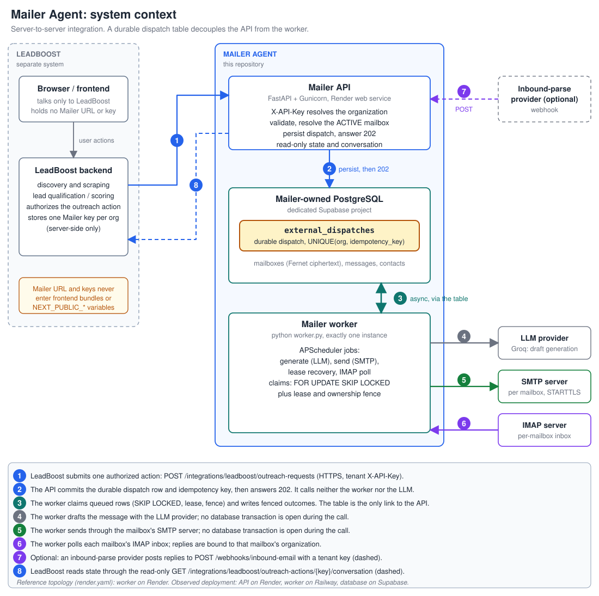
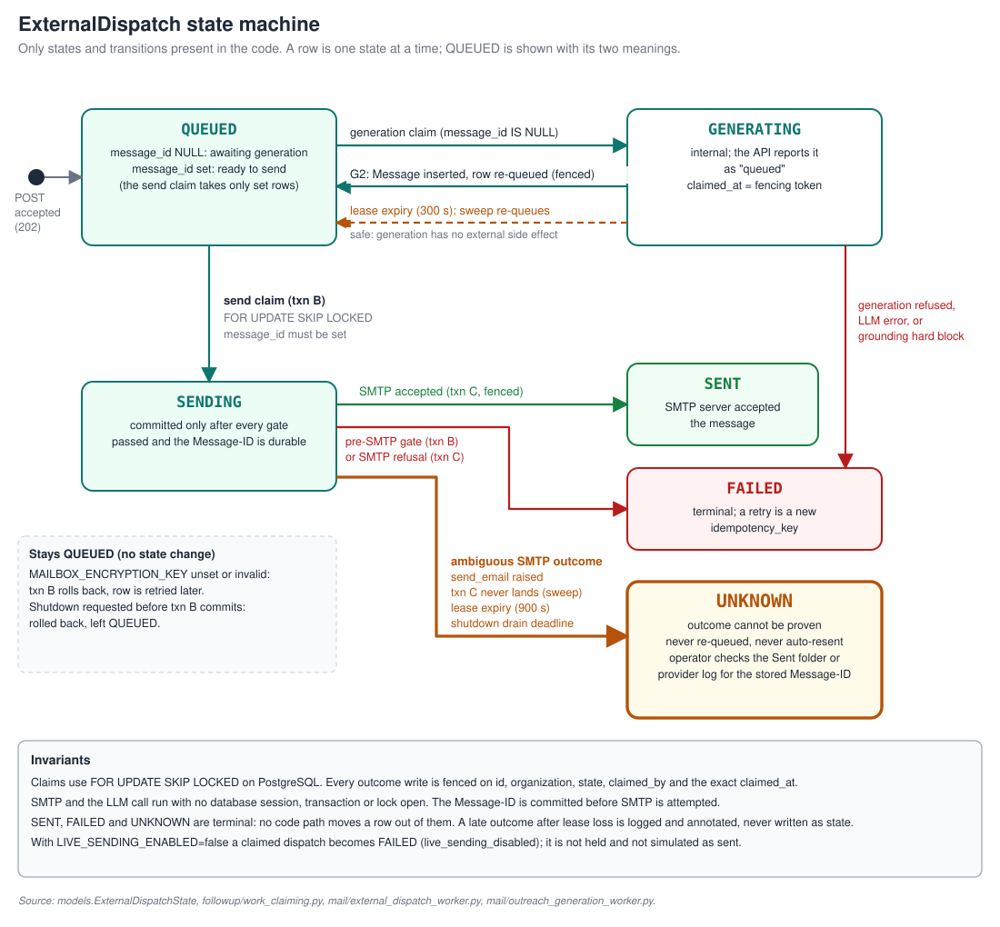
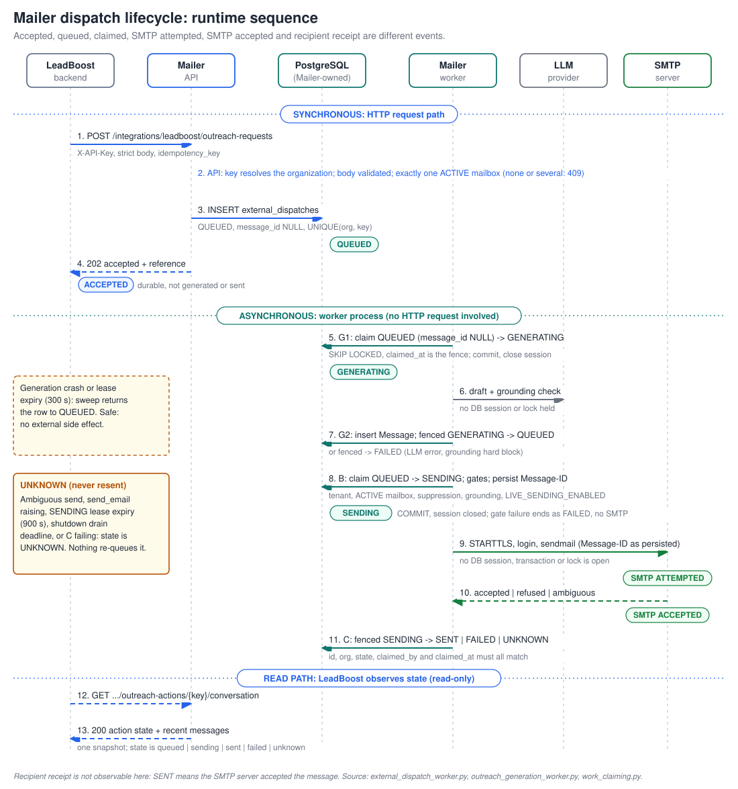

# Mailer Agent: system design

This document explains how Mailer Agent is built and why. It describes the code at the commit this documentation was written against; where behavior was observed on hosted infrastructure rather than derived from source, the text says so. Evidence labels (`CI VERIFIED`, `HOSTED OBSERVED`, `IMPLEMENTED, NOT HOST-VERIFIED`, and so on) are defined in [FINAL_PRODUCTION_READINESS.md](../FINAL_PRODUCTION_READINESS.md).

Related: [API and integration](../API_AND_INTEGRATION.md), [security](../SECURITY_AND_SECRETS.md), [deployment](../DEPLOYMENT.md), [migrations](../../migrations/README.md).

## 1. Scope, actors and trust boundaries

| Actor | Responsibility | Not responsible for |
|---|---|---|
| LeadBoost frontend | User-facing workflow in the browser | Any Mailer URL, key or credential |
| LeadBoost backend | Discovery, scraping, lead scoring; authorizing an outreach action; holding one Mailer key per organization | Sending mail, SMTP credentials, delivery state |
| Mailer API | Authenticating the tenant, validating requests, mailbox management, committing durable dispatches, read-only state | Calling an LLM or SMTP for the integration path |
| Mailer worker | Generation, sending, lease recovery, IMAP polling | Serving HTTP |
| PostgreSQL (Mailer-owned) | The only shared state between API and worker; the durable queue | Anything LeadBoost owns |
| LLM provider (Groq) | Drafting message text for generated requests | Deciding whether a message may be sent |
| SMTP server | Accepting outbound mail for one mailbox | Proving the recipient received it |
| IMAP server / inbound webhook | Delivering replies to Mailer | Identifying the tenant |

Mailer does not implement discovery, scraping or lead scoring. When the operator's local end-to-end test exercised those steps, they ran in LeadBoost.

Trust boundaries:

1. **Browser to LeadBoost backend.** Mailer is invisible to the browser.
2. **LeadBoost backend to Mailer API.** HTTPS with a tenant `X-API-Key`. The key is the only source of the organization.
3. **Mailer to its database.** Tenant isolation is enforced in queries, keyed on the organization resolved at the boundary.
4. **Worker to LLM, SMTP, IMAP.** Outbound calls made with no database transaction open.
5. **Inbound mail to application state.** Message content never selects or widens a tenant; the organization comes from the polled mailbox row (IMAP) or the presented key (webhook).

## 2. Components

| Component | Entry point | Notes |
|---|---|---|
| API | `mailer_agent/api/main.py` (`python run.py` locally; Gunicorn with Uvicorn workers on Render) | Routers: integrations, generated outreach, conversation, mailboxes, webhooks, system. `/health` is liveness only. |
| Worker | `worker.py` | Installs signal handlers, calls `init_db()`, starts one APScheduler, drains on shutdown. No HTTP endpoint. |
| Scheduler | `mailer_agent/followup/scheduler.py` | Nine jobs, each `max_instances=1`: legacy reply poll, per-mailbox inbox poll, native new-contact and follow-up dispatch, external-dispatch send, generation, two lease-recovery sweeps, a health-check log job. |
| Dispatch worker | `mailer_agent/mail/external_dispatch_worker.py` | Send claim, gates, SMTP, outcome. |
| Generation worker | `mailer_agent/mail/outreach_generation_worker.py` | Generation claim, LLM draft, grounding, `Message` creation. |
| Claim/lease logic | `mailer_agent/followup/work_claiming.py` | Claims, fenced writes, expiry sweeps. |
| SMTP sender | `mailer_agent/mail/sender.py` | Builds MIME, classifies the outcome. |
| Inbound | `mailer_agent/mail/imap_reader.py`, `mailbox_inbound.py`, `reply_handler_v2.py` | Per-mailbox polling and reply processing. |
| Credential protection | `mailer_agent/mailbox_secrets.py` | Fernet encrypt/decrypt with `MAILBOX_ENCRYPTION_KEY`. |

## 3. Synchronous path versus asynchronous processing

The API's whole job on `POST /integrations/leadboost/outreach-requests` is to decide whether to accept the request and to make that acceptance durable. It makes no LLM call and creates no `Message`. The caller gets `202` as soon as the dispatch row is committed. Everything slow, rate-limited or external (the LLM call, the SMTP conversation) happens later in the worker.

Why: an HTTP request that waits on an LLM and an SMTP server inherits both of their failure and latency modes, and a timed-out caller cannot tell whether the mail went out. With a durable row, the caller's question becomes "what state is dispatch X in?", which has a precise answer from the read-only endpoint.

## 4. The durable dispatch table

`external_dispatches` (model `ExternalDispatch`) holds one row per accepted operation:

- `UNIQUE(organization_id, idempotency_key)` makes the caller's key the operation's identity.
- `state` is one of `QUEUED`, `GENERATING`, `SENDING`, `SENT`, `FAILED`, `UNKNOWN`.
- `message_id` is NULL until generation attaches the generated `Message` (migration 008).
- `mailbox_id` records the mailbox resolved at acceptance (migration 007).
- `grounding_context` is an immutable per-dispatch snapshot of the offer and recipient facts used for drafting and for grounding the finished message (migration 005).
- `claimed_by` / `claimed_at` carry the claim, the lease clock and the fence.

The table exists, instead of an in-memory queue or a broker, because the state that must survive a crash (accepted, in flight, outcome) is the same state the API must report. One transactional store gives the idempotency check, the queue and the status read a single source of truth, and adds no service to operate. The cost is polling latency (jobs run every 15 s by default) and queue throughput bounded by one database; this document makes no throughput claim, and no benchmark exists in the repository.

## 5. Idempotency, tenant resolution and mailbox selection

**Tenant resolution.** `get_integration_org_id` maps `X-API-Key` to an organization through `ORG_KEY_MAP` (plus the optional `ORG_KEYS_<org>` variables and the legacy `API_KEY`, which maps to organization `default`). It is fail-closed: with no usable key source the API refuses to start and protected routes answer 503; an unknown or missing key is 401 with an indistinguishable body. It never honors `ALLOW_INSECURE_NO_AUTH`. The `organization_id` that LeadBoost may send in a body is not used for authorization.

**Idempotency.** The identity is `(organization_id, idempotency_key)`. The fingerprint compares `external_action_id` and recipient email. A replay of an accepted key returns the existing operation untouched; the same key with a different fingerprint is 409; two identical concurrent requests converge on the winner of the unique constraint.

**Mailbox selection.** There is no mailbox identifier in the request. The sending identity is the organization's one ACTIVE mailbox. With none, or with ambiguity, the request is refused with 409 and nothing is queued. Mailbox lifecycle is described in the [L1 contract](../LEADBOOST_L1_MAILBOX_CONTRACT.md).

**Sender persona.** The first dispatch for an organization creates a reusable integration campaign whose `From` name and address come from deployment-wide settings (`LEADBOOST_INTEGRATION_SENDER_*`). With the address unset, that first request answers 503. This is a `KNOWN LIMITATION`: every organization's integration mail shares one persona, even though each mailbox authenticates with its own SMTP credential.

## 6. Worker claims, leases and fencing

- **Claim.** `FOR UPDATE SKIP LOCKED` on PostgreSQL, oldest first, so concurrent workers never claim the same row and never block each other. SQLite ignores the row-lock clause, so the concurrency guarantees are exercised only by the PostgreSQL test suite.
- **Generation claim:** `QUEUED` with `message_id IS NULL` becomes `GENERATING`.
- **Send claim:** `QUEUED` with `message_id` set becomes `SENDING`. A `SENDING` row is never re-claimed.
- **Lease and fence.** `claimed_at` is both the lease clock and the fencing token. Every outcome write matches on id, organization, expected state, `claimed_by` and the exact `claimed_at`; a worker that lost its lease writes nothing and its late result is logged and annotated, not recorded as state.
- **Recovery.** Two sweeps run every 60 s by default. An expired generation lease (default 300 s) returns the row to `QUEUED`: generation has no external side effect, so a retry is safe. An expired send lease (default 900 s) resolves to `UNKNOWN` and never to `QUEUED`: the process may have died after SMTP accepted the message.
- **Retries.** Pre-SMTP work retries because it is safe. Inside the single SMTP call, connection-level failures before the message is transferred are retried (up to three attempts with exponential backoff); an ambiguous failure or an explicit server refusal is never retried, and no retry happens across the dispatch lifecycle. A failed dispatch is retried by the caller with a new idempotency key.
- **Single instance.** The scheduler assumes one worker process. Claims and fencing keep two workers correct, but the topology is documented as one scheduler; see [DEPLOYMENT.md](../DEPLOYMENT.md).

## 7. SMTP interaction and transaction boundaries

Send path in `external_dispatch_worker.py`:

1. **Transaction B** (one session): claim the row, re-check gates (tenant match, mailbox exists and is ACTIVE, recipient not suppressed, grounding not hard-blocked, `LIVE_SENDING_ENABLED`), decrypt the mailbox SMTP password, mint the `Message-ID`, set the message to `SENDING`, commit, close the session. A gate failure ends the row as `FAILED` inside this transaction and never reaches SMTP. If the encryption key is unset or invalid the transaction rolls back and the row stays `QUEUED`.
2. **SMTP call** with no session, transaction or lock open: STARTTLS (per mailbox setting), login, `sendmail`.
3. **Transaction C** (new session, fenced): `SENDING` to `SENT`, `FAILED` or `UNKNOWN`. Up to three attempts to write the outcome; if all fail the lease sweep resolves the row to `UNKNOWN`.

Outcome classification (`sender.py`): `sendmail()` returning means the server accepted the message and the outcome is `SENT`, even if closing the connection afterwards fails (that is logged, never retried). A failure to connect, start TLS or log in, or an explicit server refusal, is `FAILED`. Any other error raised during `sendmail()` itself is ambiguous and becomes `UNKNOWN`. With `LIVE_SENDING_ENABLED=false` a claimed dispatch is failed with `live_sending_disabled` before any SMTP call. Nothing is held and nothing is simulated as sent.

Holding no database resource across SMTP is deliberate: an SMTP server can stall for tens of seconds, and a transaction open across it would pin a connection and its locks for that time.

## 8. Message-ID persistence and the shape of `UNKNOWN`

The `Message-ID` is generated and committed in transaction B, before SMTP is attempted, and the same value goes on the wire. After any crash, the database holds the identifier the recipient's server would have seen. An operator who finds an `UNKNOWN` dispatch searches the mailbox's Sent folder or the SMTP provider's log for that identifier and learns whether the send happened.

`UNKNOWN` is terminal by design. Automatically retrying would trade a missed email for the possibility of a duplicate to the same recipient, and Mailer cannot tell which case it is in. `SENT`, `FAILED` and `UNKNOWN` have no outgoing transitions in code; the only later write to an `UNKNOWN` row is an informational note appended by `annotate_unknown_dispatch`.

## 9. Reply ingestion, mailbox ownership and deduplication

- **IMAP (per mailbox).** `poll_mailbox_inboxes_job` polls each eligible mailbox (ACTIVE with IMAP configured). The mailbox row supplies `mailbox_id` and `organization_id`. Messages are fetched without implicitly marking them seen and marked seen only after processing commits.
- **Correlation.** Replies are matched to a contact within that organization and mailbox using `In-Reply-To` and `References`. Unmatched or ambiguous mail is not persisted and not guessed at; the caller marks it seen. There is no orphan-inbound table, so such mail is not retained (`DEFERRED`, with the webhook `To:` correlation and the IMAP cursor).
- **Deduplication.** Identity is `(mailbox_id, Message-ID)`, or `(mailbox_id, "synthetic:<sha256>")` when a message has no usable id, enforced by partial unique indexes (migration 009). Another organization's copy of the same email is not treated as a duplicate.
- **Webhook.** `POST /webhooks/inbound-email` resolves the organization from the presented key and restricts its lookups to that organization's campaigns (C15.1b, per the runbook and `tests/test_c15_1b_webhook_tenant_scope.py`). It uses the pre-M3 correlation path. A comment in `api/integrations_conversation.py` still describes an unscoped lookup; see the readiness report, section 8.
- **Legacy reply poll.** `poll_replies_job` still polls one deployment-wide IMAP account configured by `IMAP_*` variables for native, non-integration campaigns.
- **Reply effect.** Replies to contacts owned by the LeadBoost integration are classified and stored. They schedule no Mailer-native follow-up or auto-reply; each send is a new request authorized by LeadBoost.

Two organizations can register the same address. Mailer does not deduplicate physical inboxes; do not give two mailboxes IMAP access to one account unless both organizations should receive its mail.

## 10. Failure modes and operational recovery

| Failure | Result | Recovery |
|---|---|---|
| API crash before commit | Nothing queued | Caller replays the same key |
| API crash after commit, before response | Row exists | Caller replays the same key and gets the existing operation |
| Worker crash during `GENERATING` | Lease expires | Sweep returns the row to `QUEUED`; regenerated |
| LLM error or grounding hard block | `FAILED`, no `Message` | Caller submits a new key |
| Encryption key missing or wrong | Send claim rolls back, row stays `QUEUED` | Fix the key; the row is retried |
| Gate failure (mailbox disabled, suppressed, etc.) | `FAILED` before SMTP | Fix cause; new key |
| Ambiguous SMTP outcome | `UNKNOWN` | Operator checks the stored `Message-ID` externally |
| Worker crash during `SENDING` | Lease expires | Sweep sets `UNKNOWN`, never `QUEUED` |
| SIGTERM | Worker drains up to `EXTERNAL_DISPATCH_SHUTDOWN_DRAIN_SECONDS` (25 s); unfinished sends become `UNKNOWN`, unclaimed work stays `QUEUED` | None needed |
| Two processes run `init_db()` on an empty database | Observed once on hosted infrastructure: a duplicate-sequence error; a later start recovered (`HOSTED OBSERVED`) | Race not yet fixed; run the migration wrapper once before starting both services (`DEFERRED`) |

### Delivery guarantees and their limits

Three different things are easy to conflate, and Mailer only controls the first two.

| Event | What Mailer can say | What it cannot say |
|---|---|---|
| Database durability | Once the API returns `202`, the dispatch row has been committed to PostgreSQL. It survives an API or worker crash. | That it survives loss of the database itself: durability beyond the commit is the database provider's (and the backups') property, and Mailer adds no replication. A committed dispatch may also end as `FAILED` or `UNKNOWN`; "durable" means recorded, not delivered. |
| SMTP acceptance | `SENT` means the mailbox's SMTP server accepted the message during this dispatch's single send. | That the server will deliver it. It can still defer, bounce or drop the message later; bounce handling is deferred (`KNOWN LIMITATION`). |
| Recipient receipt | Nothing. It is not observable from Mailer. | Whether the message reached an inbox, a spam folder or nowhere. |

What the design does to limit duplicates and losses:

- **Organization-scoped idempotency.** `(organization_id, idempotency_key)` is unique, so replays and concurrent duplicates of the same key converge on one dispatch. This protects only against repeats of the same key: a caller that submits the same logical action under a new key creates a second dispatch.
- **Leased, fenced claims.** At most one worker holds a valid claim, and every outcome write must match the exact claim. Fencing governs what is *recorded*; it cannot unsend a message. A `SENDING` row is never re-claimed, so a second worker does not repeat the send.
- **Pre-SMTP `Message-ID`.** The identifier is committed before SMTP is attempted, so after any crash the stored record names the message a server may have received, and an operator can check for it.
- **`UNKNOWN` instead of blind retry.** An outcome that cannot be proven is recorded as such and is not retried. This deliberately trades the risk of a duplicate for the risk of a missed email, and it requires an operator to reconcile.

Residual risks (`KNOWN LIMITATION`): an `UNKNOWN` dispatch whose send did not actually happen stays unsent until someone acts; a caller or operator can create duplicates by resubmitting under a new key; restoring the database from a backup taken before a send can make `QUEUED` rows that were already sent look unsent again (reconcile before restarting the worker); and the single-send property has been exercised in tests and a local workflow, not demonstrated against real providers on the hosted deployment. Exactly-once delivery is not claimed.

## 11. Deployment topology

Two topologies exist and they are not the same.

- **Reference (`render.yaml`).** A Render web service (API with `RUN_SCHEDULER_IN_PROCESS=false`) and a Render worker running `python worker.py`, against an external PostgreSQL supplied as `DATABASE_URL`. The Blueprint provisions no database.
- **Observed.** API on Render at `https://mailer-agent-api.onrender.com`, worker on a Railway service running `python worker.py`, database on Supabase. Treat this as a split-provider staging or demo deployment. A second Railway service named `web` (a Gunicorn API process) has also been seen; whether it has been removed is unconfirmed, and it is not part of the intended topology.

See [DEPLOYMENT.md](../DEPLOYMENT.md) for sequencing and [the runbook](../C13_DEPLOYMENT_RUNBOOK.md) for procedures.

## 12. What this design does not claim

No throughput, latency, availability, RTO or RPO figure is stated, because none is measured in the repository. Recipient receipt is unobservable. Hosted end-to-end delivery has not been verified.
